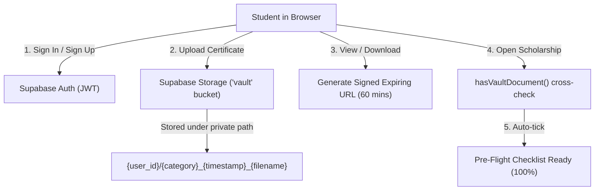

# Yojna Sathi (ScholarSync)
> **Know every document you need before you start applying.**

[](https://developer.mozilla.org/en-US/docs/Web/JavaScript)
[](https://tailwindcss.com/)
[](https://supabase.com/)
[](https://lucide.dev/)
[](https://vitejs.dev/)

---

## Table of Contents

1. [Project Overview & USP](#1-project-overview--usp)
2. [Key Architecture & File Structure](#2-key-architecture--file-structure)
3. [Supabase Integration & Setup Guide](#3-supabase-integration--setup-guide)
   - [Step 1: Create a Free Supabase Project](#step-1-create-a-free-supabase-project)
   - [Step 2: Retrieve API Keys & Configure `config.js`](#step-2-retrieve-api-keys--configure-configjs)
   - [Step 3: Setup Supabase Authentication](#step-3-setup-supabase-authentication)
   - [Step 4: Create Private Storage Bucket](#step-4-create-private-storage-bucket)
   - [Step 5: Configure Row Level Security (RLS) Policies](#step-5-configure-row-level-security-rls-policies)
   - [Signed URLs & Zero-Config Demo Mode](#signed-urls--zero-config-demo-mode)
4. [Local Development](#4-local-development)
5. [Data Model Reference](#5-data-model-reference)
6. [Extending Content](#6-extending-content)
7. [Contribution Guidelines](#7-contribution-guidelines)
8. [Disclaimer](#8-disclaimer)

---

## 1. Project Overview & USP

**Yojna Sathi** (ScholarSync) is a student-centric scholarship and government scheme aggregator designed to eliminate the **"Form-Filling Blindspot"**. 

In most government scholarship portals (such as SVMCM, Kanyashree, Aikyashree, and OASIS), required documents, formatting restrictions, and specific proofs are only revealed midway through multi-page, timed application sessions. Students frequently abandon sessions halfway through because they lack a required document or certificate.

### Unique Selling Points (USPs)

* 📋 **Pre-Flight Document Checklist & Audit**: Displays the complete prerequisite document checklist upfront before students initiate an application. Categorizes documents into **Mandatory** and **Optional/Situational** with a real-time, percentage-based Readiness Audit progress bar.
* 🔐 **Digital Vault (Supabase-Powered)**: A secure, account-based document locker where students upload certificates once (Aadhaar, income certificate, marksheets, bank passbook, etc.).
* ⚡ **Auto-Preflight Checklist Pre-Ticking**: When a student opens any scholarship, Yojna Sathi cross-references the scheme's requirements with their Digital Vault. Existing documents are automatically pre-checked with a verified badge, instantly updating the readiness audit score.
* 📦 **1-Click Application Pack Manager**: Allows students to select any scheme and download a bundle of all verified documents required for that specific portal submission.
* 🗜️ **Built-in Image & Photo Compressor**: In-browser client-side image compressor (using HTML5 Canvas) to resize photos and specimen signatures to portal limits (e.g. under 50KB or 100KB) without transmitting sensitive student files to external third-party servers.
* 🤖 **Sync Assistant (AI Knowledge Base)**: Interactive guidance providing safe document alternatives (e.g., using Madhyamik admit card or Aadhaar if a formal birth certificate is absent) or direct tap-to-call helpline routing for documents with no legal substitute.

---

## 2. Key Architecture & File Structure

Yojna Sathi is deliberately built with a **clean, dependency-free front-end architecture**: no Node bundler, no framework overhead, and no build pipeline. It runs directly in any modern browser using lightweight CDN scripts.

```
yojna-sathi/
├── index.html        # Main semantic markup: Header, Views (Home, Detail, Vault), Modals
├── style.css         # Minimal styling (animations, focus ring, typography)
├── config.js         # Supabase configuration credentials & client initialization
├── auth.js           # Supabase Auth: Sign-up, Sign-in, Sign-out, Session & UI state
├── vault.js          # Digital Vault: Uploads, signed URLs, document matching & Application Pack
├── script.js         # Core scheme data, audit calculations, view router, AI assistant & compressor
└── README.md         # Comprehensive project documentation
```

### Script Execution & Dependency Order
In `index.html`, scripts are intentionally loaded in the following sequence at the close of `<body>`:

1. **Supabase JS Client (`@supabase/supabase-js@2`)**: Provides the official Supabase SDK.
2. **`config.js`**: Defines `SUPABASE_URL` and `SUPABASE_ANON_KEY`, initializing the `supabaseClient`.
3. **`auth.js`**: Sets up authentication listeners, user state management, and modal controllers.
4. **`vault.js`**: Handles vault data storage, document-matching algorithms, and the Application Pack manager.
5. **`script.js`**: Loads scholarship data, handles view toggling (`showHome`, `openScheme`, `showVault`), and executes document pre-checking.

---

## 3. Supabase Integration & Setup Guide

The Digital Vault feature uses **Supabase Auth** for student accounts and **Supabase Storage** for encrypted document uploads and secure signed downloads.



Follow the step-by-step instructions below to link your live Supabase project.

### Step 1: Create a Free Supabase Project
1. Visit [supabase.com](https://supabase.com) and create an account or sign in.
2. Click **"New Project"**.
3. Choose an organization, provide a **Project Name** (e.g. `yojna-sathi-vault`), set a secure database password, and select your nearest region.
4. Click **"Create new project"** and wait for deployment to complete (~1-2 minutes).

### Step 2: Retrieve API Keys & Configure `config.js`
1. In your Supabase Dashboard, navigate to **Project Settings** (gear icon) -> **API**.
2. Copy the **Project URL** and the **`anon` `public` key**.
3. Open `config.js` in your repository and update lines 11 and 12:

```javascript
// config.js (Lines 11-12)
var SUPABASE_URL = "https://your-project-id.supabase.co";
var SUPABASE_ANON_KEY = "eyJhbGciOiJIUzI1NiIsInR5cCI6IkpXVCJ9...";
```

### Step 3: Setup Supabase Authentication
1. In the Supabase Dashboard, go to **Authentication** -> **Providers**.
2. Select **Email** and ensure it is **Enabled**.
3. *(Optional for Development)*: Under **Authentication** -> **URL Configuration**, you can uncheck **"Confirm email"** if you want student accounts to be active immediately without waiting for an email confirmation link.

### Step 4: Create Private Storage Bucket
1. In the Supabase Dashboard, go to **Storage** -> **Buckets**.
2. Click **"New bucket"**.
3. Set the **Bucket Name** to:
   ```text
   vault
   ```
4. **Do NOT enable "Public bucket"**. Leave it **Private** so that student certificates (Aadhaar, income proofs, etc.) remain inaccessible to the public internet.
5. Click **"Save bucket"**.

### Step 5: Configure Row Level Security (RLS) Policies
Because student documents contain sensitive personally identifiable information (PII), strict Row Level Security (RLS) ensures students can **only access their own files**.

1. In your Supabase Dashboard, navigate to the **SQL Editor** (left navigation).
2. Click **"New query"**, paste the SQL script below, and click **Run**:

```sql
-- Enable Row Level Security on Storage Objects
ALTER TABLE storage.objects ENABLE ROW LEVEL SECURITY;

-- 1. Policy: Students can view and download ONLY their own documents
CREATE POLICY "Students can view own vault documents"
ON storage.objects FOR SELECT
TO authenticated
USING (
  bucket_id = 'vault' 
  AND (storage.foldername(name))[1] = auth.uid()::text
);

-- 2. Policy: Students can upload documents ONLY to their own folder
CREATE POLICY "Students can upload to own vault folder"
ON storage.objects FOR INSERT
TO authenticated
WITH CHECK (
  bucket_id = 'vault' 
  AND (storage.foldername(name))[1] = auth.uid()::text
);

-- 3. Policy: Students can delete ONLY their own documents
CREATE POLICY "Students can delete own vault documents"
ON storage.objects FOR DELETE
TO authenticated
USING (
  bucket_id = 'vault' 
  AND (storage.foldername(name))[1] = auth.uid()::text
);
```

### Signed URLs & Zero-Config Demo Mode

* **Secure Signed URLs**: Files stored in the private `vault` bucket are downloaded using Supabase's `createSignedUrl(filePath, 3600)`. This generates an ephemeral download link valid for 1 hour. Direct links are never exposed publicly.
* **Zero-Config Demo Mode**: If you run Yojna Sathi without configuring Supabase keys in `config.js`, the platform detects the placeholders and automatically runs in **Offline Demo Mode**:
  * You can click **"Use Demo Account"** in the login modal to log in as a test student immediately.
  * You can click **"+ Load Sample Docs"** inside the Digital Vault to pre-load sample Aadhaar, Marksheet, Income, Passbook, and Photo records.
  * File downloads, document checklists, and application pack bundling will work seamlessly offline using simulated local storage.

---

## 4. Local Development

Because Yojna Sathi requires no bundler or Node compilation, getting started locally takes less than 10 seconds.

### Option A: VS Code Live Server (Recommended)
1. Open the repository folder in **Visual Studio Code**.
2. Install the **Live Server** extension (`ritwickdey.LiveServer`).
3. Right-click `index.html` and select **"Open with Live Server"**.
4. The application opens at `http://127.0.0.1:5500`.

### Option B: Python Simple HTTP Server
If you have Python installed:
```bash
# Python 3
python -m http.server 5500
```
Open `http://localhost:5500` in your browser.

### Option C: Node.js `serve` / `npx`
```bash
npx serve .
```

---

## 5. Data Model Reference

### Scheme Definition (`script.js`)
```javascript
{
  id: "svmcm",                              // Unique scheme identifier
  name: "Swami Vivekananda Merit-cum-Means",// Official title
  short: "SVMCM",                           // Abbreviation
  dept: "Dept. of Higher Education",        // Government department
  icon: "award",                            // Lucide icon name
  color: "bg-blue-600",                     // Tailwind badge/logo color
  status: "open",                           // "open" | "closing" | "soon"
  window: "Typically Aug – Nov (yearly)",   // Application window description
  deadline: "Check portal – usually early Nov",
  elig: "West Bengal resident, merit + income criteria",
  mode: "Online",                           // "Online" | "Offline" | "Online + Offline"
  helpline: "1800-000-0000",
  docs: [
    ["Aadhaar card", "m"],                  // "m" = Mandatory
    ["Caste certificate", "o"]              // "o" = Optional / Situational
  ]
}
```

### Vault Category Model (`vault.js`)
Vault documents are categorized to enable keyword matching against scheme requirements:
```javascript
{
  id: "aadhaar",
  label: "Aadhaar Card",
  icon: "credit-card",
  keywords: ["aadhaar", "aadhar", "adhar"]
}
```

---

## 6. Extending Content

### Adding a New Scheme
To add a new scholarship scheme, append a new object to the `schemes` array in `script.js`:
```javascript
schemes.push({
  id: "tarun",
  name: "Taruner Swapno",
  short: "Tarun",
  dept: "School Education Dept., Govt. of West Bengal",
  icon: "smartphone",
  color: "bg-cyan-600",
  status: "open",
  window: "Typically Dec – Jan",
  deadline: "Check school circular",
  elig: "Class 12 students in WB government-aided schools",
  mode: "Via School Portal",
  helpline: HELP,
  docs: [
    ["Aadhaar card", "m"],
    ["Bank passbook (first page)", "m"],
    ["Institution enrolment proof", "m"]
  ]
});
```

### Adding Document Substitutions to the Assistant
To add guidance when a student lacks a document, add an entry to the `kb` array in `script.js`:
```javascript
kb.push({
  k: ["domicile", "residential", "address"],
  t: "Residential proof",
  a: "You can use your <b>Ration card, Voter ID, Aadhaar card, or electricity bill</b>.",
  call: false
});
```

---

## 7. Contribution Guidelines

We welcome contributions to expand scheme coverage, improve the document audit accuracy, and enhance student accessibility.

1. **Fork the Repository**:
   ```bash
   git clone https://github.com/your-username/yojna-sathi.git
   cd yojna-sathi
   ```
2. **Create a Feature Branch**:
   ```bash
   git checkout -b feature/add-national-scholarship-portal
   ```
3. **Follow Architectural Guidelines**:
   * **Keep it dependency-free**: Do not introduce bundlers (Webpack, Vite) or UI frameworks (React, Vue) without prior discussion. Plain HTML5, Tailwind, and vanilla ES6 JavaScript maintain maximum accessibility for learners.
   * **Preserve Global DOM IDs**: Do not rename IDs in `index.html` without updating corresponding references in `script.js`, `auth.js`, and `vault.js`.
   * **Render Icons**: Call `lucide.createIcons()` after any dynamic HTML insertion containing `<i data-lucide="...">`.
   * **Input Sanitization**: Always use `textContent` (or sanitize user text) when outputting dynamic content to prevent XSS vulnerabilities.
   * **Mobile-First Responsiveness**: Test your layouts at ~360px width up to desktop viewports (`sm:`, `md:`, `lg:` breakpoints).
4. **Submit a Pull Request**:
   * Describe the changes clearly.
   * Ensure console errors are zero.

---

## 8. Disclaimer

**Yojna Sathi is an independent educational and utility aggregator and is NOT an official government website.** 

Dates, document checklists, eligibility criteria, and helpline numbers provided are illustrative aggregations. Students must always verify rules and deadlines on the official scholarship portals (e.g. `wb.gov.in`, `banglaruchchashiksha.wb.gov.in`) before submitting applications. Document substitutions suggested by the AI Sync Assistant are guidance only; final acceptance is determined solely by the issuing government department.

---

## License

This project is licensed under the [MIT License](LICENSE). Feel free to adapt and build upon it for public good.
